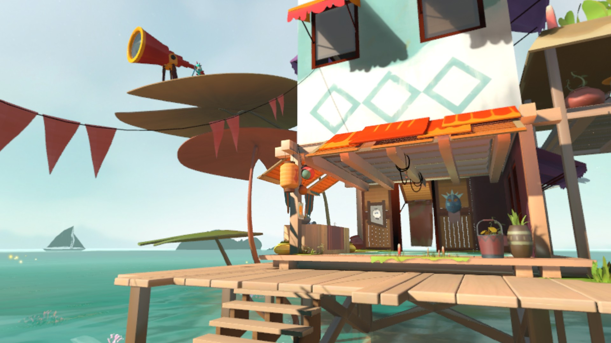
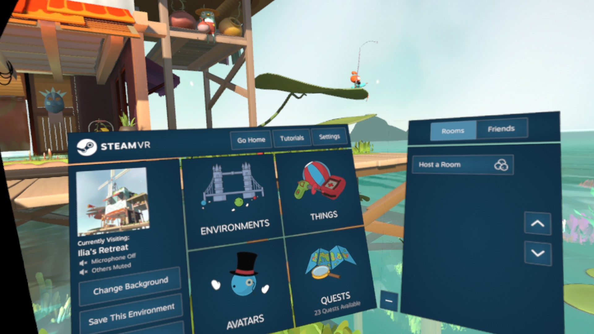
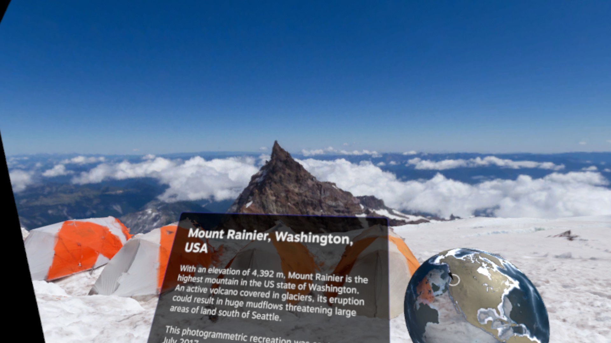

# SteamVR Home on Steam Frame

## TLDR: how to install

1. On your **Steam Frame**, select **[Download the installer — SteamVR-Home-Frame-Install.run](https://github.com/Puffy288/steamvr-home-frame/releases/download/v0.1.0/SteamVR-Home-Frame-Install.run)**. Save it in **Downloads**. This is the only file you need; you do not need a source-code ZIP.
2. Open **Konsole**, paste this with the thumbstick’s right-click menu, then select **Enter** on the on-screen keyboard:

```bash
bash ~/Downloads/SteamVR-Home-Frame-Install.run
```

3. Wait for **Installed**. Open **Library → Non-Steam → SteamVR Home (Frame - Unofficial) → Play**.

**Never used the Frame’s desktop? [Follow the short walkthrough](START-HERE.md).** Keep Steam running and signed in during setup.

## TLDR: what this is

A fun experiment: SteamVR Home running locally on your Frame. Explore Workshop environments, or take a world you’ve made along with you—no PC streaming needed. One installer handles the downloads and adds Home to your library.

**Unofficial and experimental. Created with AI assistance.**

## See it running

Screenshots from SteamVR Home running on Steam Frame. Both environments below are made by Valve.

**Ilia’s Retreat** — [get it on Steam Workshop](https://steamcommunity.com/sharedfiles/filedetails/?id=927882107)



**Home’s menu in Ilia’s Retreat**



**Mount Rainier** — [get it on Steam Workshop](https://steamcommunity.com/sharedfiles/filedetails/?id=1180765965)

Snow, rocks, and puffy clouds above the mountain.



To download either environment, open its Workshop page while signed into Steam, select **Subscribe**, and let Steam finish the download. Find it in Home’s **Environments** menu.

## What gets installed

The installer downloads SteamVR Home from Valve through your Steam client, sets up the compatibility files, and adds **SteamVR Home (Frame - Unofficial)** to your library. It reuses files you already have.

**You do not need to install FEX separately.** FEX lets the Frame run Home’s PC Linux application. Setup finds Valve’s FEX runtime or asks Steam to install it automatically. No administrator password is needed.

This requires Steam Frame running SteamOS VR. Setup checks for the Frame components it needs. [System changes](SYSTEM-CHANGES.md) covers the files, download sources, and settings in detail.

## Playing and closing Home

Choose **Play** from its library entry. Home opens the environment you saved as your home. To close it, choose **Stop** in **Currently Running Games** or on its library page.

The desktop mirror is hidden, so Home does not need a separate desktop window. If you want that window visible, add `--show-mirror` to the shortcut’s launch options.

Home uses the Frame’s existing controls: trigger/bumper to use things, grip for inventory, stick up to teleport, and stick left/right to turn. Sound plays through the headset. The library entry uses Valve’s SteamVR Home cover and small icon.

## Performance and Workshop downloads

The graphics profile keeps shadows, lighting, scene effects, and 4× anti-aliasing. Home adjusts its render scale while running. Workshop environments range from simple rooms to ultra detailed landscapes, so performance varies with what you visit.

**Already subscribed to lots of environments?** Steam may download them when Home starts. Downloading and unpacking can cause extra stutter. Let those downloads finish, or pause them in Steam, for smoother play. You only need the environment you want to visit to finish downloading.

## Where it goes

`~` means your home folder. Setup prints the exact locations when it finishes.

| Location | Contents |
| --- | --- |
| `~/.local/share/steamvr-home-frame/` | Launcher, private game layout and settings, compatibility files, documentation, and logs. |
| `~/.cache/steamvr-home-frame/` | Setup downloads, artwork, and progress files. |
| Your Steam library | Official Home files and Valve’s FEX runtime. |

Folders starting with a dot are hidden. In the file manager, open its menu and select **Show Hidden Files** to see them.

If you need to uninstall, close Home and run:

```bash
bash ~/.local/share/steamvr-home-frame/Uninstall.sh
```

This removes its library entry and keeps the private folder as `steamvr-home-frame.uninstalled` so your settings remain recoverable. Shared Steam downloads, FEX, and Workshop content stay in place. [More uninstall details](SYSTEM-CHANGES.md#updates-and-uninstall).

## If something goes wrong

- **Setup cannot reach Steam:** enable **CEF Remote Debugging** in Steam’s **Developer** settings, restart Steam, and rerun the installer. Some versions first require Developer Mode. You can turn this setting off after setup; playing Home does not need it.
- **Play fails:** check the error dialog and the `logs` folder in the install location. Running `bash ~/.local/share/steamvr-home-frame/Launch.sh` in Konsole shows launcher messages. The Frame’s SteamVR runtime must be running.
- **Another Home is running:** close it before starting another instance.
- **Audio is missing:** check the headset output and app volume.
- **A download fails:** check Steam’s connection and available storage, then rerun the installer.
- **A Steam or SteamOS update breaks Home:** close Home and rerun setup. Setup keeps the previous private installation as a backup.

## About the project

This is a community installer, unaffiliated with Valve. It runs Home locally using Valve’s FEX translation and native Vulkan forwarding where available. The release contains the installer’s source, configuration, documentation, and screenshots; Home itself is downloaded from Valve.

Project code is MIT-licensed. Downloaded components and game artwork retain their own rights and licenses. See [SYSTEM-CHANGES.md](SYSTEM-CHANGES.md) for the technical details.
